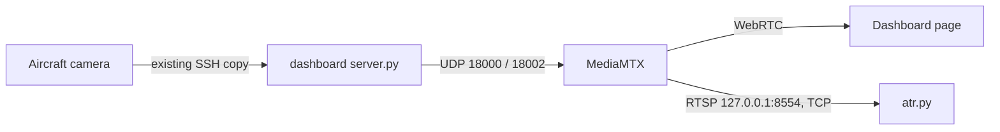

# People and vehicle recognition (ATR)

`atr.py` watches the Cruza and quadpi video on the ground laptop. It draws boxes
around **people** and **vehicles** (car, truck, bus, motorcycle, bicycle, train,
boat), gives each one a track number, and logs when it appears and disappears.

It runs only on the laptop. It reads the dashboard's local copy of each video
feed and has no SSH, aircraft, MAVLink, camera or flight-controller access.
Nothing aboard either aircraft was changed, and stopping it affects nothing aboard.

## Start it

Double-click **`Start recognition.cmd`** in this folder. On the first run it:

1. Creates a private Python environment in `atr\runtime\venv` and installs
   OpenCV (video decoding/drawing) and ONNX Runtime (runs the model). Needs internet.
2. Starts the dashboard and opens it in the browser, if it is not already running.
   **Keep that dashboard page open and unpaused**: it is what pulls video from
   the aircraft. Pausing it pauses recognition too.
3. Downloads the detection model once (36 MB) into `atr\models` and checks its SHA256.

A window per aircraft then shows the video with boxes. Press **q** in a video
window, or Ctrl+C in the console, to stop.

If the dashboard was already running before this feature was added, the launcher
says so; run `dashboard\stop-dashboard.ps1` once and start again so it picks up
the new configuration.

Options (add after `start-atr.ps1`, or run `atr.py` directly):

| Option | Effect |
|---|---|
| `--model yolox_tiny` or `yolox_nano` | Faster, less accurate. Use if the frame rate shown in the window is low. Default `yolox_s`. |
| `--threshold 0.5` | Report only more-confident detections (default 0.35). |
| `--min-hits 5` | Sightings needed before a target is reported (default 3). Higher = fewer false alarms, slower to report. |
| `--snapshots` | Save a cropped picture of each new target. |
| `--no-window` | Log only. |
| `--source NAME=URL` | Use other video, e.g. `--source test=C:\clips\flight.mp4` or a webcam `--source cam=0`. Repeatable. |

## Output

Each run writes `atr\runtime\detections-<UTC time>.jsonl` (one JSON record per line):

- `target_start`: a person/vehicle was seen in 3 consecutive frames.
- `target_update`: once per second while it stays visible.
- `target_end`: not seen for 1.5 s. Includes `seconds_tracked` and `best_score`.

`box` is `[left, top, right, bottom]` in video pixels; `score` is model
confidence from 0 to 1. With `--snapshots`, pictures go to
`atr\runtime\snapshots-<UTC time>\`. The `runtime` and `models` folders are not
committed.

## How it works

- `dashboard/mediamtx.yml` now also offers each feed as RTSP on
  `127.0.0.1:8554` (this laptop only, TCP only, no new UDP ports, no
  re-encoding). Feeds are `rtsp://127.0.0.1:8554/cruza` and `.../quadpi`.
- A reader thread per feed keeps only the newest frame, so recognition stays on
  live video even if the laptop is slower than the camera. It reconnects every
  3 s when a feed is missing.
- The detector is **YOLOX** (Apache-2.0 licence) trained on the COCO image set,
  from the official release, run on the laptop CPU. Duplicate boxes are merged
  per category, so one vehicle is not reported as both "car" and "truck".
- A simple tracker links boxes across frames by overlap to keep track numbers
  steady and suppress single-frame false alarms.

## Verified and not verified

Verified in a Linux test environment on 2026-10-19:

- Seven unit tests: `python -m unittest test_atr` (box maths, class filtering,
  duplicate removal, tracker confirm/expiry, checksum rejection).
- End to end with MediaMTX v1.21.2 and this repository's `mediamtx.yml`: a
  test clip sent as H.264 RTP to UDP 18000, the way Cruza's copy arrives, was
  read over RTSP; the bus and people in it were recognized, tracked and logged,
  and the absent quadpi feed was reported as waiting. Only `127.0.0.1:8554`
  TCP was added to MediaMTX's listeners.

**Not verified:** the Windows launchers (`Start recognition.cmd`,
`start-atr.ps1`, `install-atr.ps1`), real aircraft video, and frame rate on
this laptop.

## Limitations

- COCO models learned from ground-level photos. From altitude, people and cars
  are small and seen from above, so expect missed detections above roughly
  40-60 m and at Cruza's 640×480. Lower altitude, the `detail` video profile, or
  a model trained on drone imagery (such as VisDrone) would improve this.
- Recognition happens after video crosses LTE/mesh, so it inherits the video's
  delay and drops out when the link does.
- Results are labels from a model, not confirmed identifications.
