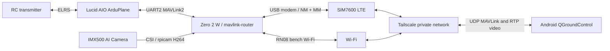

# Cruza Pi companion deployment

Software is installed on the Pi. LTE internet, Headscale access through cellular
NAT and one session-recovery test are verified. Pi UART configuration and
monitoring are verified after reboot; AIO data reception and Android QGC video
reception remain incomplete.
This is not an accepted flight system. See the
[initial audit](../docs/pi-companion-audit-2026-10-14.md). Commands below run on
the Pi unless identified as laptop/Android steps. No script issues aircraft
arm, disarm, mission, mode or parameter-write commands.



## Deployment sequence

1. Confirm HAT USB data and power wiring with the owner. The audit saw only a
   USB root hub. Plugging the Pi into PWR IN does not provide the modem data path.
   `lsusb` must show the modem; `mmcli -L` must detect it after installation.
2. Owner enters sudo password locally to start installation independently of SSH:
   `sudo systemd-run --unit=cruza-install --collect /bin/bash /home/ebach/companion/install.sh`.
   Follow progress with `journalctl -fu cruza-install`; Ctrl+C stops only the
   log viewer. Do not power down while the installer is active. The helper
   `sudo -n /usr/local/sbin/cruza-powerdown` refuses shutdown during this installer,
   package installation or Ninja builds. It is a helper, not an OS-wide shutdown
   inhibitor; direct shutdown commands still bypass it.
   This preserves existing config and backs up prior Cruza files under
   `/var/backups/cruza/TIMESTAMP`. Packages install from signed repositories.
   mavlink-router v4 is built only if absent, with exact commit recorded.
   Existing router installations are preserved and require version review.
   Package installation is not rolled back automatically.
3. `sudo bash ~/companion/configure-uart.sh`, then reboot when the owner is
   ready. This removes GPIO serial console, enables UART and disables Bluetooth.
   It changes Pi configuration only. Do not leave the AIO wired to a Linux
   console. UART restore instructions below.
4. Inspect `mmcli -L`, `mmcli -m INDEX`, `nmcli device status`, and `lsusb -t`.
   Identify kernel driver (qmi_wwan/cdc_mbim/cdc_ether/rndis_host), data interface,
   SIM readiness, registration and signal. Prefer the detected mode supported
   by NM/MM. If unsupported, stop and diagnose rather than switching firmware.
   Inspect existing profiles before `sudo bash ~/companion/configure-lte.sh --create`.
   The APN is based on this SIM's previously verified laptop test. Do not embed
   SIM PIN or credentials in project files.
5. Record modem data interface in `/etc/cruza/config.json`. LTE metric 700 keeps
   Wi-Fi metric 600 preferred on the bench. Verify `ping -I INTERFACE` and
   `curl --interface INTERFACE https://example.com`, plus DNS lookup, to avoid
   mistaking Wi-Fi internet for LTE. Compare LTE-assigned address to external
   address using a trusted IP service when diagnosing NAT; private/100.64/10
   addresses indicate upstream NAT. IPv6 availability does not prove no NAT.
6. This laptop uses the existing Headscale server `https://headscale.rotopter.com`.
   Run `sudo tailscale up --login-server=https://headscale.rotopter.com --hostname=tfwcruza`
   and approve the generated registration request under the intended existing
   Headscale user. Public login.tailscale.com enrollment joins a different control
   server and is not the selected architecture. Install Tailscale on Android,
   select this same custom control server and register it under the intended user.
   Do not enable an exit
   node or subnet routes. Get Pi/phone IPs with `tailscale ip -4`/Android app.
   Set `android_ip` to the specific phone address in `/etc/cruza/config.json`.
   Use tailnet grants restricted to this Android source and Pi destination:
   UDP 14560 for MAVLink and SSH 22 only if remote administration is intended.
   Pi-to-phone UDP 5600 must be permitted for video. Default permissive grants
   should be reviewed. Avoid joining an unrelated shared administrative tailnet.
7. Confirm AIO wiring and live serial parameters. Historical SERIAL2 is disabled.
   Proposed communication settings: SERIAL2_PROTOCOL=2, SERIAL2_BAUD=115,
   SERIAL2_OPTIONS=0. Record before/after exports; apply only after confirming
   the actual connection. These scripts do not change FC parameters. Keep
   SERIAL4/ELRS and SERIAL6/GPS intact. Confirm `/dev/serial0` and no getty.
8. `sudo bash ~/companion/activate-router.sh` adds an independent nftables
   table, accepts MAVLink only from the configured Android over tailscale0,
   binds router to the Pi tailnet IP, disables TCP listener and enables router
   startup. It refuses to replace an existing firewall table. Do not bridge
   ELRS radio telemetry into the same router, which can create duplicate loops.
9. Android QGC: record the actual app version; add explicit UDP link with local
   port 14550 and server `PI_TAILNET_IP:14560`. Connect so QGC sends its heartbeat
   to the router. No broadcast discovery is assumed. Verify autopilot heartbeat,
   GPS/map and state before attempting a command.
10. Android video source: `UDP h.264`, receiving port 5600 (or UDP URL
    `0.0.0.0:5600` where that app version exposes it). Enable low latency if
    available. Start a session with `sudo systemctl start cruza-video`, stop
    with `sudo systemctl stop cruza-video`. No video starts on boot. If the
    installed Android build lacks the source/decoder, record exact version
    and diagnose; desktop documentation alone is not proof of compatibility.

## Video, resource usage and data allowance

Profiles in config: economy 640x480/15 FPS/300 kbps, standard 400 kbps,
detail 960x540/15 FPS/500 kbps. Restart video after changing profile. rpicam
encodes H264; GStreamer only parses and packetizes RTP, with periodic SPS/PPS
and 1200-byte RTP packets. Video uses lower process priority and low-priority
DSCP, but networks may ignore DSCP. This is not guaranteed telemetry bandwidth
reservation. Measure both paths under congestion and disable/reduce video if
telemetry responsiveness degrades. Do not claim QoS is validated before testing.

Estimated encoded payload: 135 MB/hour at 300 kbps, 180 MB/hour at 400 kbps,
225 MB/hour at 500 kbps (decimal MB). Add RTP/IP/VPN and telemetry overhead.
24 GB/year allows about 178/133/107 hours of video payload respectively if
the entire allowance were devoted to video. Real usable time is lower.
Example-config sessions stop after 1800 seconds; the live Pi currently uses a
120-second bench-test limit. Failure retries are bounded by
systemd (three starts per five minutes). Sessions require manual start; there
is no viewer detector or automatic bitrate adaptation. A restarted failed
session starts a new duration window. QGC closing alone does not stop video;
explicitly stop it. Automatic viewer-based control can follow validation.

Usage samples LTE interface RX/TX once per minute and persists daily UTC
buckets plus month/cumulative summaries. Set the actual data interface after
detection. First sample is a baseline; traffic before monitoring and just
before abrupt counter resets/reboots may be missed. Counts include other
traffic on that interface and differ from carrier billing. Monthly default
warning is 2 GB, logged, not pushed to Android. Check remaining allowance in
the carrier account. No automatic flight-affecting action occurs on a warning.

Benchmark 15 minutes with LTE, router and video simultaneously: temperature,
`vcgencmd get_throttled`, `free -m`, `pidstat` if installed, process CPU/RSS,
video observed FPS/loss and QGC telemetry. No software transcoding. Five-second
local camera success does not establish this load test.

## Diagnostics and recovery

```bash
python3 /opt/cruza/cruza.py diagnose
sudo python3 /opt/cruza/cruza.py usage
journalctl -u cruza-router -u cruza-video -u cruza-lte-health -u cruza-usage --since today
mmcli -L
mmcli -m INDEX
nmcli device status
tailscale status
tailscale ping ANDROID_TAILNET_IP
ss -lunp
sudo nft list table inet cruza
```

Diagnostics identify OS, power, camera, modem enumeration, interface, VPN and
service state. They do not claim vehicle heartbeat or command ACK visibility.
Use QGC MAVLink Inspector/router statistics for message rates, heartbeat, GPS,
mission progress and ACKs. Inspect modem output locally; do not publish SIM
identifiers. LTE health retries only the named inactive profile every five
minutes; active bearer outages are left to NetworkManager/ModemManager. A
failed ICMP probe logs a warning, never resets the modem or FC. DNS failures
need independent lookup; failed ping alone is not proof of a dead bearer.
Router restarts on process failure with 30-second backoff; VPN/network outages
do not restart the FC. No command queues, replay or auto-arm logic are added.

## Command matrix and validation

No motor/arming/motion tests are authorized by installation. Owner confirmation,
props removed and a separate test session are required for those tests.

| Operation | Prerequisites / expected evidence | Current status |
|---|---|---|
| Heartbeat, GPS/map, battery/mode | AIO MAVLink and router active; QGC inspector and vehicle display | Blocked by UART/VPN setup |
| Parameter read | Matching system ID, completed download; no writes | Not verified |
| Mission download | QGC request/list/items/ack, match saved mission | Not verified |
| Mission upload | Owner selects reviewed plan, mission ACK accepted, download comparison | Not verified |
| Arm/disarm | Owner-approved props-off bench; normal pre-arm validation and COMMAND_ACK | Not verified |
| Mode/RTL | Firmware-supported mode, owner-approved bench; ACK when command-based, verify HEARTBEAT mode; SET_MODE need not produce ACK | Not verified |
| Start mission | Separate owner-approved motion test; accepted command and actual mission state | Not verified |
| Pause/resume | Check ArduPlane/QGC support; no unsupported translation | Not verified |
| RC authority | Confirm switch/stick takeover per live Plane configuration | Not verified on new path |

Acceptance status:

| Criterion | Status / evidence |
|---|---|
| Pi SSH, OS, camera detection | Verified live SSH audit and after reboot |
| Camera H264 capture | Verified five-second file, not live Android stream |
| LTE internet on Pi | Verified: QMI session, LTE-bound ping/DNS/HTTPS passed |
| VPN through cellular NAT / Android endpoints | Verified reachability: private SSH and phone probe with Pi Wi-Fi disconnected; QGC endpoints still need app validation |
| Heartbeats, GPS, bidirectional commands, missions | Blocked: Pi UART ready; live FC settings/VPN/routing pending |
| Video inside Android QGC | Not verified |
| Combined CPU/RAM/power load | Not verified; short camera test has no throttling flag |
| Configurable video bitrate | Partially verified: files/config and rpicam test; profiles not streamed |
| Boot startup / individual recovery / LTE outage | Partially verified: network/monitoring services restart; NM recovered one bearer disconnect; LTE cold boot, prolonged outages and router/video recovery remain pending |
| Usage measurement | Partially verified in counter logic tests; live LTE interface pending |
| Existing RC/failsafes preserved | Partially verified: no FC changes; new path bench test pending |
| No automatic arming/replay | Verified by source: no flight-command sender; end-to-end reconnect pending |
| LTE loss does not destabilize aircraft | Not verified in combined test; FC remains independent by architecture |
| Safety changes require approval | Existing settings untouched; no safety writes in installer |

Before flight: fresh full FC export; review RC loss, GCS loss (historically
disabled), GPS loss, low battery, reboot and AUTO mission continuation behavior.
Bench-disconnect LTE while QGC monitors state; confirm no unexpected command
on reconnection. Crash/restart Pi software while FC remains stable. Mission
transfer/read checks precede separately authorized arming/motor checks.
Mount securely, verify power topology/current spikes, cooling, antennas,
weight/CG and RC range with Pi/modem/video active. Controlled flight testing
requires the owner's explicit go-ahead and a confirmed independent RC link.

## Backup and rollback

Password-free shutdown is installed by `sudo bash ~/companion/install-powerdown.sh`
or at the end of the main installer. It permits only the no-argument,
root-owned `/usr/local/sbin/cruza-powerdown` helper for the existing owner account.
The home-directory script is not authorized by sudoers. Installation validates
sudoers and saves prior files under `/var/backups/cruza/powerdown-TIMESTAMP`.
Restore that backup (or remove only `/etc/sudoers.d/cruza-powerdown` if it did
not previously exist) to revoke this permission. Do not test it by executing
the helper unless an actual shutdown is intended.

Record `systemctl is-enabled` state and config diffs before subsequent changes.
Stop/disable only `cruza-router`, `cruza-video`, `cruza-usage.timer`,
`cruza-lte-health.timer` and `cruza-firewall`. Delete only the `inet cruza`
firewall table (`sudo nft delete table inet cruza`), never flush all rules.
Restore Cruza files from the recorded backup and reload systemd. Restore
`config.txt`/`cmdline.txt` from the UART backup; reenable hciuart/getty only if
they were previously enabled, then reboot. Remove only the created cruza-lte
profile if reverting LTE. Existing Wi-Fi/ELRS/FC remain untouched. Tailscale
logout and service/package removal are separate deliberate rollback steps;
do not remove a previously existing installation. Installed dependencies are
recorded in packages.tsv, not automatically uninstalled.
