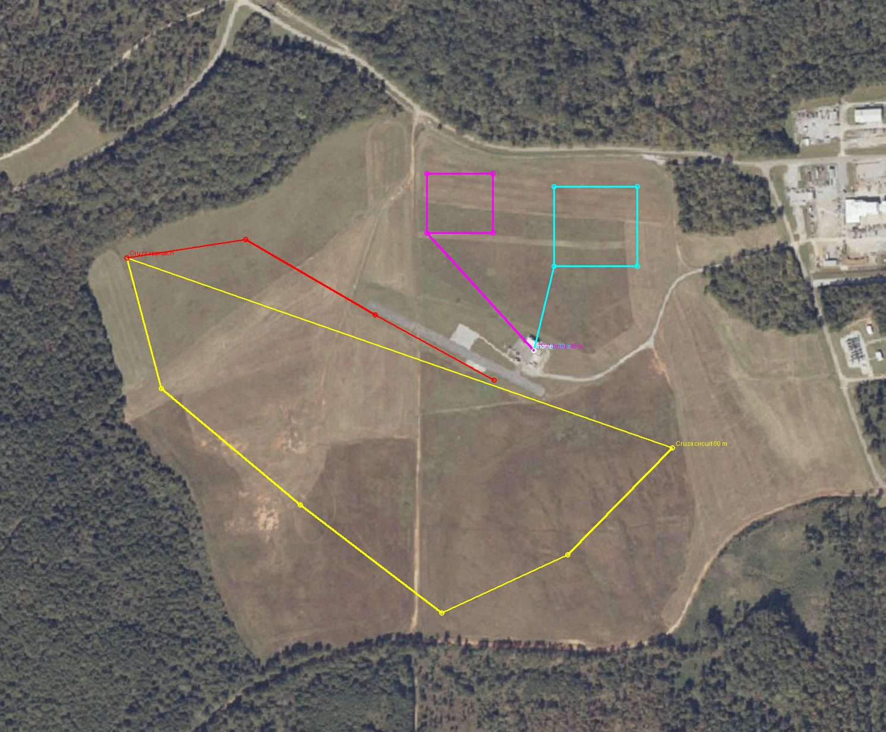

# Handover test, 30 Oct 2026: Cruza cue → operator approves → quad flies its own mission

**The flow under test:**
1. The Cruza flies its circuit with detection running.
2. A detection becomes a handover card on the dashboard, with a picture.
3. The operator approves the card to **quadpi** or **TFW drone**.
4. That quad arms and flies the mission already on its flight controller.

There are two separate handovers, one per quad.

The cue's position is **not** used: each quad flies its own uploaded route. The approval
opens that quad's **Arm & fly mission** review, with the mission read back from the
aircraft. **One Send click launches it.** Nothing launches without that click.

## Routes

Yellow is the Cruza circuit, red the Cruza approach, cyan quadpi and magenta TFW drone.
White is the launch point by the building.

| Aircraft | File (in `Documents\QGroundControl\Missions`) | Height | What it flies |
|---|---|---|---|
| Cruza | `Cruza_Shallow_Approach_4p6deg_5LAPS_2026-10-30.plan` | 60 m | Today's circuit **5 times** (about 10–11 min in the air; today's laps took about 110 s each), then today's approach and landing, unchanged |
| quadpi | `quadpi_Handover_NorthField_30m_2026-10-30.plan` | 30 m | Takeoff to 20 m, 5 m/s, a 133 × 139 m box in the north field twice, then RTL. About 5 min |
| TFW drone | `TFWdrone_Handover_NorthField_40m_2026-10-30.plan` | 40 m | Takeoff to 20 m, 5 m/s, a 100 × 111 m box in the north field twice, then RTL. About 5 min |

- **Cruza:** the 5-lap file differs from today's 3-lap file **only in the lap count**
  (one DO_JUMP repeat, 2 → 4). The takeoff, circuit, approach (40 m → 20 m → land, 5.9°
  glide slope) and landing are byte-for-byte the same. If the battery is in doubt, fly
  today's 3-lap file instead: about 6 min in the air, so the quads have to be quick.
- **Separation:**
  - Both quad boxes are at least **160 m** from the Cruza's circuit and approach, and
    **100 m** from each other.
  - They are also at different heights: 30 m, 40 m and the Cruza's 60 m.
  - The transit from the launch point passes **77 m** from the Cruza's return leg, at
    20–40 m against its 60 m.
- **The quads end with RTL**, so they return to wherever they armed and land there. Their
  missions must finish **before the Cruza starts its approach** (after lap 5). The
  launch point is 75 m from the Cruza's landing point.
- quadpi's 27 Oct racetrack is **not** reused: it sits at the Cruza's south-east turn.
- The dashboard checks each mission before launch: it must start with a takeoff, stay at
  or below 120 m and within 1.5 km of home, and match what you reviewed.

## Before the flight

1. **Upload the three routes** with QGC, one aircraft at a time. Read each one back.
2. **Power up all three**, quads **props off**:
   - Cruza: flight power, not USB.
   - quadpi: in shade if possible; it ran at 85 °C on 29 Oct.
   - TFW drone: on Wi-Fi or mesh, not cellular.
3. **Start the dashboard with both links.** I'll do this:
   `start-dashboard.ps1 -QuadControl 10.223.79.20:14551 -TfwControl 100.100.0.6:14551`.
   Both quads must show **LIVE**, and Arm & fly mission must show each mission's
   read-back (items, takeoff height, farthest point).
4. **quadpi check, props off.** Arm then Disarm from the dashboard. It proves the
   command path, which video and telemetry don't. TFW drone was tested on 29 Oct.
5. **Transmitters:** each quad's mode switch in STABILIZE, throttle low. One safety
   pilot per quad.
6. **Targets:** set out two, **more than 120 m apart**, under the Cruza's circuit,
   **not** in the north field. For example, a parked car and a person along the
   south-west legs. Closer than 120 m, two targets of the same class merge into one card.
7. **Start the recorder** (I'll run it): `python dashboard/handover_monitor.py`.

## The flight

| Step | Who | What |
|---|---|---|
| 1 | Cruza pilot | Launch the Cruza (AUTO, 5-lap file) |
| 2 | Dashboard | Cards appear with pictures as the Cruza passes the targets |
| 3 | Operator + quadpi pilot | Say aloud **"props on, area clear"** for quadpi |
| 4 | Operator | On the first card: aircraft **quadpi**, command **Arm & fly mission** → **Approve handover**. The mission review opens → check it → **Send to quadpi** within 20 s, otherwise the review expires and you press Review again |
| 5 | Operator + TFW pilot | Say aloud **"props on, area clear"** for TFW drone |
| 6 | Operator | On the second card: aircraft **TFW drone**, **Arm & fly mission** → **Approve** → check → **Send to TFW drone** |
| 7 | Everyone | Both quads fly their boxes and RTL. Confirm both have landed and disarmed **before the Cruza's last lap ends** |
| 8 | Cruza pilot | The Cruza flies its approach and lands as usual |

**Abort and take over.** Use the quad's mode switch, or the dashboard's RTL or Land, if:
- a quad heads anywhere other than its box;
- a link goes offline;
- the Cruza is about to start its approach while a quad is still flying;
- anyone says stop.

## What's recorded (all on the laptop, nothing new on the aircraft)

| File | What it shows |
|---|---|
| `dashboard/runtime/handover-monitor-<time>.jsonl` | Timeline: each card appearing, its picture arriving, your decision, each quad's launch result, armed/mode changes, and any dashboard dropout |
| `dashboard/runtime/handover.log` + `handover/*.jpg` | Every approval or denial, with the picture you looked at |
| `dashboard/runtime/quad-commands.log`, `tfw-commands.log` | Each command sent and the aircraft's acknowledgement |
| Each aircraft's flight log | Pull afterwards over USB |

After landing, `python dashboard/handover_monitor.py --summary <that file>` gives, per
card: how long the picture took, how long until your decision, and how long from
approval to launch.

## Pass criteria

| Check | Target |
|---|---|
| Cards appear from the Cruza in flight, with a picture | Both targets |
| Each approval opens the right quad's mission review | Yes |
| One Send launches that quad on its own mission | Both, accepted by the aircraft |
| Each quad flies its box and returns | Yes, with no takeover needed |
| Timeline recorded end to end | Card → picture → decision → launch, for both |
